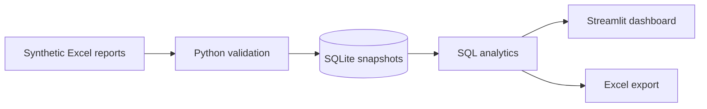

# Inventory Intelligence

A local inventory analytics application that converts daily stock reports into a historical SQLite dataset, actionable stock indicators, and downloadable Excel reports.

## Business problem

Daily inventory reports are often isolated spreadsheets. This project centralizes dated stock snapshots and distinguishes sellable inventory from stock in receiving or damaged areas, supporting visibility for operations and commercial teams.

## Features

- Synthetic Excel data generator: 14 days, 30 fictional SKUs, 3 stock areas.
- Validated Excel ingestion with atomic snapshot replacement and explicit overwrite consent.
- SQLite storage with a unique key per date, SKU and stock area.
- SQL aggregations for available, receiving and damaged stock, plus financial valuation.
- Streamlit dashboard with date selection, historical trends, brand and category analysis, and zero-availability filters.
- Downloadable Excel reports containing the selected snapshot and history.
- Automated tests and GitHub Actions, with no paid services or API keys.

## Architecture



## Quick start (Windows PowerShell)

```powershell
py -3.14 -m venv .venv
.\.venv\Scripts\python.exe -m pip install -r requirements.txt
.\.venv\Scripts\python.exe -m pytest -q
.\.venv\Scripts\python.exe -m src.generate_samples
.\.venv\Scripts\python.exe -m streamlit run app.py --server.address 127.0.0.1 --browser.gatherUsageStats false
```

Open `http://127.0.0.1:8501`. Alternatively, select **Load synthetic demo** within the dashboard. Re-running the generator preserves previously imported dates.

## Input contract

Each XLSX has a `Stock` sheet with columns `SKU`, `Product`, `Brand`, `Category`, `Area`, `Quantity`, `Unit Cost`. SKU must be text to preserve leading zeros. Areas: `AVAILABLE`, `RECEIVING`, `DAMAGED`. Quantities are nonnegative integers; costs are BRL amounts with at most two decimal places. Each SKU requires an explicit AVAILABLE row, even when zero. The date is supplied separately and must represent the entire snapshot. Duplicate SKU/area rows and inconsistent metadata are rejected. Money is stored as integer cents.

## Metric definitions

- Available units: units in the AVAILABLE area only.
- Receiving units: units in the RECEIVING area; not sellable.
- Zero-availability SKUs: reported SKUs with zero AVAILABLE units.
- Total stock value: sum of quantity × unit cost across all three areas.

Snapshots are point-in-time observations, not sales transactions. Missing SKUs are not assumed to have zero stock. No demand forecasting, ERP integration or automatic email distribution is implemented. The demo assumes one site and one currency; no inventory movements are inferred from daily differences.

## Privacy

All demo data is fictional. Generated files and the SQLite database are excluded from Git. This is an independently implemented portfolio demonstration, not a production ERP replacement. Do not upload confidential data. The application is designed for local use and makes no AI API calls.
